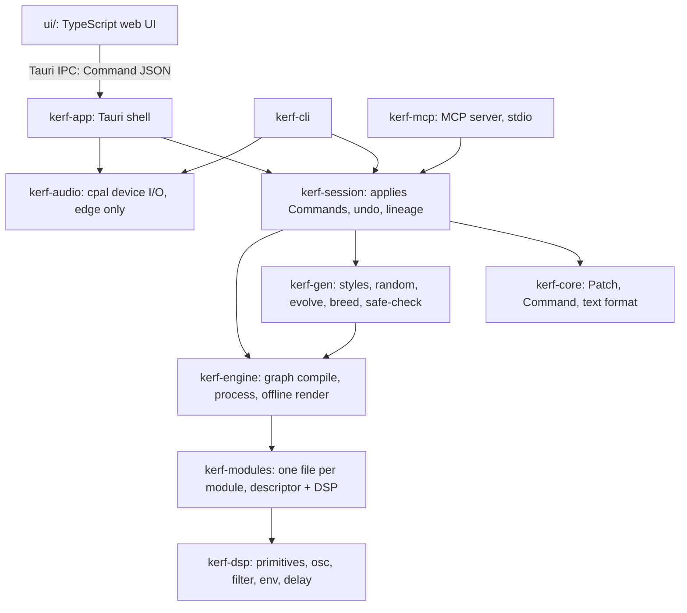

# Kerf Modular: plan

Status: planning + browser mockup (24 Nov 2026). No Rust code yet.

## 1. What it is

A modular audio playground. A patch is a set of modules joined by cables.
It is driven three ways, all equal: the GUI, a CLI, and AI agents over MCP.

Inspired by three products, copying none of their names or layouts:

| Source | What we take | Where it stops, and our answer |
|---|---|---|
| Chassis (Lux Cache) | A fixed, curated module set that is learnable; typed jacks with colours; any output to any input | Steep learning curve, and the dice rewires the whole case at once → **Explain mode** and **Evolve** with locks |
| Modurand | Random lands a wired, playing rack in a style; parts; Variation; hover help | Each roll replaces the last, with no lineage → **lineage tree**, **breed**, **safe random** |
| PAM (MAP Audio) | Scoped randomiser (genre, scale, parts); agent control; morph crossfader | Agents use a side channel → **one command protocol** that every front end uses |

## 2. The six ideas (agreed with Danny, 24 Nov 2026)

1. **One command protocol.** Every change to a patch is a `Command`
   (add module, set param, cable, randomise, evolve, …). The GUI, CLI and MCP
   server send the same commands to the same `Session`. Undo, history,
   scripting and agent control are one mechanism, not four.
2. **Evolve, not only Random.** Lock a knob, a module or a whole part, then:
   - `random`: a new patch from a style rulebook
   - `evolve`: mutate the unlocked parts (strength 0–1)
   - `breed A B`: cross two patches from the lineage
   Every result is a node in a **lineage tree**. Nothing is lost.
3. **Safe random.** Before a generated patch is shown, it is rendered offline
   for a few bars and checked: audible, peak under −1 dBFS, no DC, no runaway
   feedback, in the style's key. A failed roll is retried with the next seed.
   You never get a dead roll.
4. **Patch as text.** `.kerf` files are plain, ordered, diffable text, easy for
   agents and git. The JSON form is for the wire only.
5. **Explain mode.** Point at a module and see the signal path that feeds it
   and where it goes, described in plain English, beyond what tooltips say.
6. **Morph.** Four scenes, A–D. One fader glides every unlocked knob between
   them. Scenes are part of the patch, so agents and the CLI can morph too.

## 3. Architecture

Clean architecture: the core has no I/O and no UI types. I/O lives at the edges.



### Crates (Cargo workspace)

| Crate | Job | Depends on |
|---|---|---|
| `kerf-core` | `Patch`, `ModuleId`, `Cable`, `ParamValue`, `Command`, `.kerf` text parse/print, `serde` types. Pure. | none |
| `kerf-dsp` | DSP primitives, no allocation in `process` | none |
| `kerf-modules` | Module registry. Each module = `ModuleDescriptor` (params, jacks, tooltips, band) + `impl Module` | core, dsp |
| `kerf-engine` | Compile `Patch` to a processing graph; block processing; offline render; lock-free param/graph swap | core, modules |
| `kerf-gen` | Style rulebooks, `random`, `evolve`, `breed`, safe-check via offline render; seeded, deterministic | core, engine, modules |
| `kerf-session` | Owns the `Patch`; applies `Command`s; undo/redo; lineage tree; scenes and morph; emits `Event`s | core, gen, engine |
| `kerf-audio` | cpal output and input; feeds the engine | engine |
| `kerf-cli` | `kerf` binary (clap) | session, audio |
| `kerf-mcp` | MCP server: tools map 1:1 onto `Command` | session |
| `kerf-app` | Tauri 2 shell; serves `ui/`; bridges IPC to session | session, audio |
| `ui/` | Vite + TypeScript; no framework lock-in beyond what the panel needs | none |

### Key contracts

```rust
// kerf-core (phase 1, implemented). JSON wire form: {"op":"set_param",...}
pub enum Command {
    AddPart { id: PartId, name: String, colour: Colour },
    AddModule { kind: String, id: Option<ModuleId>, part: Option<PartId> },
    RemoveModule { id: ModuleId },
    SetParam { module: ModuleId, param: Key, value: f32 }, // normalised 0..=1
    Connect { from: JackRef, to: JackRef },
    Disconnect { from: JackRef, to: JackRef },
    Lock { target: LockTarget, locked: bool },             // module | param | part
    Mute { part: PartId, muted: bool },
    SetTempo { bpm: f32 },
    StoreScene { scene: Scene },
    ClearScene { scene: Scene },
    Morph { a: Scene, b: Scene, t: f32 },
    Undo,
    Redo,
}
// Phase 3 adds Random { style, seed }, Evolve { strength, seed },
// Breed { a, b, seed }, Checkout { node }; phase 4 adds Transport { play }.

// kerf-modules
pub trait Module: Send {
    fn descriptor(&self) -> &'static ModuleDescriptor;
    fn process(&mut self, io: &mut ProcessIo<'_>); // no alloc, no locks, no I/O
}
```

Every `ParamDescriptor` and `JackDescriptor` carries a `tooltip: &'static str`.
The GUI tooltips, the CLI `kerf describe` output and the MCP tool docs are all
generated from those strings, so there is one source of help text.

### Real-time rules

- Audio thread: no allocation, no locks, no syscalls, no logging.
- Graph changes are compiled off-thread and swapped in with a lock-free handoff
  (`rtrb` / `arc-swap` style); old graphs are dropped off-thread.
- Params: atomics or SPSC queue; smoothed per block.
- Signal convention: audio ±5 V nominal (float ±1.0 internally), pitch 1 V/oct,
  gates 0/10 V (>1 V counts as high).

## 4. `.kerf` text format (draft)

All params are normalised `0..=1`; each module maps them to its own units.
Indented `module` lines belong to the part above; modules with no part come
before the first part. `lock` after a module locks it; `lock=a,b` locks params.

```
kerf 1
tempo 118
key A minor
style dub-chamber seed 4821

module tally1 Tally tempo=0.45 swing=0.1 divide=0.5

part bass "Bass" colour #3d63c9
  module seq1 Dovetail steps_a=0.5 interlock=0.4
  module osc1 Chisel   tune=0.25 shape=0.35 lock=tune
  module flt1 Plane    cutoff=0.42 res=0.6 mode=0 lock

cable tally1.clock -> seq1.clock
cable seq1.pitch -> osc1.voct
cable osc1.saw -> flt1.in

scene A osc1.shape=0.35 flt1.cutoff=0.42
scene B osc1.shape=0.8 flt1.cutoff=0.7
```

## 5. Modules (v1: 25, now 37, in six bands)

All names are ours, from joinery and woodwork (a kerf is the cut a saw leaves).

| Band | Module | Job |
|---|---|---|
| Time | **Tally** | Clock and transport: tempo, swing, divisions, bar pulse |
| Time | **Dovetail** | Two interlocking step lanes (1–16 steps each); lane B fills lane A's gaps; chance, glide |
| Time | **Inlay** | Drawn note pattern: 16 steps on a one-octave piano roll; transpose, octave shift and transpose CV; length 1–16; clock or free-run; pitch, gate and accent out; same-row neighbours tie |
| Time | **Ruler** | Four Euclidean trigger lanes, each with its own length; rotate; chance on lanes B–D (lane A always plays) |
| Time | **Fret** | Quantiser: root, scale, octave |
| Time | **Mitre** | Chord maker: one note in, four chord voices out; 14 chords, inversion, spread, optional snap to a scale |
| Time | **Rung** | Arpeggiator: plays up to four voices as a pattern (up, down, random, as played and more), over 1 to 4 octaves; swing, ratchet, accent |
| Motion | **Spokeshave** | Four LFOs whose rates are spaced like spokes |
| Motion | **Burl** | Random: stepped, smooth drift, coin-toss gate |
| Motion | **Bevel** | Envelope, ADSR with curve and end-of-cycle |
| Motion | **Level** | Envelope follower with threshold gate |
| Motion | **Jig** | Four macros, morphable between scenes |
| Motion | **Rocker** | LFO: sine to stepped random, tempo sync, reset, inverted and pulse outs |
| Motion | **Tread** | Eight hand-set steps with length, direction (forward, back, pendulum, random), glide and clock |
| Motion | **Warp** | Slow pitch drift and noise, with wander that can be tuned from smooth to rough |
| Motion | **Chatter** | A spring that you knock: position, velocity and moving outputs |
| Voices | **Chisel** | Analogue-style VCO: saw, square, sine, sub |
| Voices | **Siren** | Dub siren and bleep machine: LFO-dived oscillator, long release, filter and drive |
| Voices | **Lathe** | Wavetable voice; "turn" sweeps the table |
| Voices | **Ply** | Stacked, detuned voices (supersaw-like) |
| Voices | **Mallet** | Modal percussion: material, size, strike, damping |
| Voices | **Mortise** | Drum voice: kick, snare, hat, clap, tom engines |
| Voices | **Veneer** | Sampler and slicer |
| Voices | **Splinter** | Granular sampler: position, spray, size, density, pitch, reverse |
| Voices | **Sawdust** | Noise: coloured noise and crackle |
| Voices | **Static** | Detuned radio: tuned hiss, whistles, crackle, fading, ghost station |
| Shape | **Plane** | Multimode filter: LP, BP, HP, notch |
| Shape | **Clamp** | VCA ↔ low-pass gate |
| Shape | **Rasp** | Drive and wavefolder |
| Shape | **Vise** | Compressor with sidechain |
| Shape | **Splice** | FM, AM, ring and sync modulator with its own ratio oscillator |
| Space | **Bandsaw** | Tape-style delay with wear |
| Space | **Dado** | Dub echo: tempo sync, throw, filtered and saturated feedback, wobble |
| Space | **Shavings** | Granular cloud with freeze |
| Space | **Kiln** | Reverb: size, heat (damping), bloom |
| Out | **Router** | Six-channel mixer with a send |
| Out | **Finish** | Master: glue, ceiling, meter, record |

Bevel, Burl, Level, Jig, Spokeshave, Rocker, Tread and Chatter each have a `depth` param that scales their CV output. At the default of 1 the output is unchanged; at 0 it holds still (Spokeshave holds at 5 V).

Jack kinds and colours (light theme): audio green, CV cobalt, pitch plum,
gate ochre, clock brick. Colours guide; any jack connects to any jack.

## 6. Styles (generator rulebooks) and presets

A style picks: parts, module pools per part, tempo range, key/scale pool,
param ranges, cable rules and FX sends. Rulebooks are data (TOML), so new
styles need no code.

Rhythm rule (Danny, 24 Nov 2026): most styles keep a straight anchor (a
four-on-the-floor kick, say) and set a few other voices to chance and
polyrhythm: lanes of different lengths (Ruler, Dovetail) and per-hit
probability below 1, so no two bars are quite alike. Rulebooks give ranges
for lane lengths and chance per part; the anchor part may stay at 16 steps
and full chance.

| Style | Tempo | Parts |
|---|---|---|
| Dub Chamber | 112–122 | drums, stab pad, texture, long delay |
| Acid Line | 126–136 | drums, acid bass (Plane + Rasp) |
| Slow Grain | 60–80 | pad, granular texture, lead |
| Broken Joinery | 124–132 | drums, modal perc, bass |
| Foundry | 136–146 | distorted drums, noise texture, bass |
| Tape Keys | 78–90 | keys pad, dusty drums |

Factory presets (v1): First Cut (tutorial voice), Harbour Fog, 303 Offcuts,
Long Exposure, Broken Hinge, Steel Shop, Cassette Cabinet, Morning Sawmill.

## 7. CLI and MCP surface

```
kerf new --style dub-chamber --seed 4821 -o fog.kerf
kerf evolve fog.kerf --strength 0.3 --lock bass
kerf breed a.kerf b.kerf -o child.kerf
kerf render fog.kerf --bars 8 -o fog.wav
kerf check fog.kerf            # safe-check report as JSON
kerf describe Plane            # params, jacks, tooltips
kerf play fog.kerf             # live, reads commands from stdin (JSON lines)
kerf mcp                       # MCP server on stdio
```

MCP tools: `patch_get`, `patch_apply` (a list of commands), `random`,
`evolve`, `breed`, `lineage`, `render`, `check`, `describe_module`.
Agents read the patch back as `.kerf` text after each change.

## 8. Phases

| Phase | Deliverable | Done when |
|---|---|---|
| 0 | Plan, AGENTS.md, HANDOVER.md, browser mockup | Danny approves layout and modules |
| 1 ✓ | Workspace; `kerf-core` (Patch, Command, `.kerf` round-trip); `kerf-session` undo | `kerf new` / `kerf describe` work headless (done 24 Nov 2026) |
| 2 ✓ | `kerf-dsp` + 8 core modules (Tally, Dovetail, Chisel, Plane, Clamp, Bevel, Router, Finish); engine; offline render | `kerf render` writes an audible WAV (done 24 Nov 2026; engine runs per sample for now) |
| 3 ✓ | `kerf-gen`: six styles, random, evolve, breed, locks, lineage, safe-check | 100 seeds per style pass the check (done 25 Nov 2026) |
| 4 ✓ | `kerf-audio` live playback; `kerf-mcp` | An agent builds and plays a patch (done 25 Nov 2026) |
| 5 ✓ | Tauri app + web UI from the mockup; explain mode; morph | GUI parity with the CLI (done 25 Nov 2026; Tauri file dialogs and scene morph not exercised by hand) |
| 6 ✓ | All 25 modules with DSP, six styles, eight presets | v1 (done 25 Nov 2026) |

## 9. Decisions on the open questions (Danny, 24 Nov 2026)

- Polyphony: mono only in v1. One pitch per cable; Ply stacks detuned layers of one note.
- Samples: user folders only; no bundled kit.
- Arrange/timeline: not in v1; scenes plus morph cover performance.
- Plugin build (CLAP/VST3 via nih-plug): after v1; keep the engine plugin-ready.
- Tempo: patch tempo drives Tally; Tally's Tempo knob is a ±10% nudge, centre exact.

## 10. Open

Nothing open.
